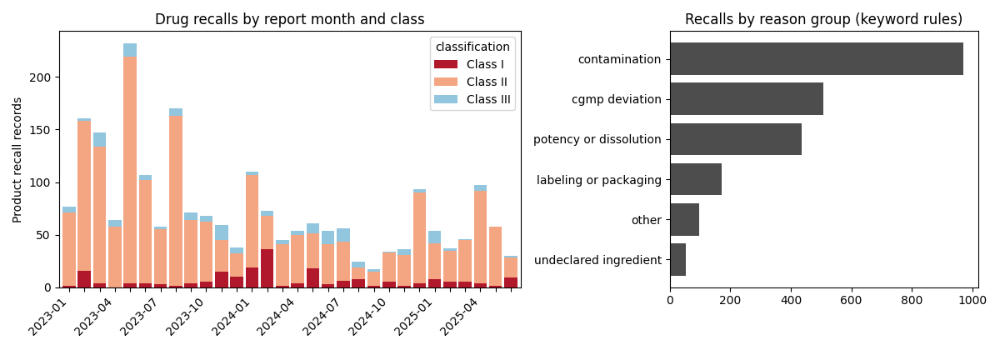

# openFDA drug recall pipeline (extract, clean, DuckDB, tests, CI)

A small but complete data pipeline: pull drug recall records from the openFDA enforcement API, clean them, load them into DuckDB, run data quality checks, and produce reporting tables. It has unit tests that run offline, and a GitHub Actions workflow that runs them on every push.

The point of the project is the engineering, not a new finding. The other repos in this account are analyses. This one shows the same kind of data handled the way a team would want it handled: repeatable, checked, and tested.

## What it does

```
openFDA drug/enforcement  ->  extract.py   one month at a time, 100 per page, retry on errors
                          ->  transform.py  trim, uppercase firm names, parse dates, drop duplicates,
                                            group the free-text reason with keyword rules
                          ->  load.py       DuckDB table `recalls`, 5 quality checks, 4 report queries
                          ->  data/*.csv    results
```

Run on January 2023 to June 2025 it pulled 2,231 product-level recall records. All 5 quality checks passed.

## Results (Jan 2023 to Jun 2025)

- Reasons (keyword groups): contamination or sterility problems 43.5%, cGMP deviations 22.7%, potency or dissolution 19.6%, labeling or packaging 7.6%, undeclared or unapproved ingredient 2.3%, other 4.3%. Undeclared ingredients are only 2% of records but 47 of the 52 are Class I, the most serious class.
- Class I is 205 records, Class II 1,847, Class III 179.
- Time from the recall starting to FDA reporting it: median 43 days for Class I, 29 for Class II, 26 for Class III (90th percentile 93, 57 and 41 days).
- A handful of firms and events dominate the counts. One pharmacy services firm (Central Admixture Pharmacy Services) accounts for 236 records from 4 events, and its name appears in two spellings.



## Limits

- One record is one recalled product, not one recall event. A single event can cover hundreds of products, which is why the firm counts are so lopsided. Count `event_id` if you want events.
- The reason groups come from simple keyword rules in `transform.py`, applied in order, so a record that mentions two things goes to the first match. They are for rough grouping. I did not measure how accurate they are.
- Firm names are only trimmed and uppercased. "CENTRAL ADMIXTURE PHARMACY SERVICES, INC." and "... SERVICES INC" are still counted separately. Real entity matching is not done here.
- Windows are by FDA report date, so a recall started in 2022 can show up in 2023.
- openFDA data is unvalidated and the recall records can be revised after the fact.
- The data quality checks cover structure (keys, dates, class values). They cannot tell you whether the content is right.

## Tests

```
python -m unittest discover -s tests -v
```
10 tests: month-window edge cases (year end, leap year), URL building, paging stops on a short page (fake fetcher, no network), cleaning rules, deduplication, quality checks that fail when they should, and report totals. I used the standard library `unittest` because pytest was not available where I built this. The GitHub Actions workflow in `.github/workflows/ci.yml` runs the same command.

## Run it

```
pip install duckdb pandas matplotlib
python src/run.py 2023-01 2025-06
python src/chart.py
```
The raw JSON lines (3 MB) and the DuckDB file are written to `data/` when you run it and are not kept in the repo. The CSV reports are.
